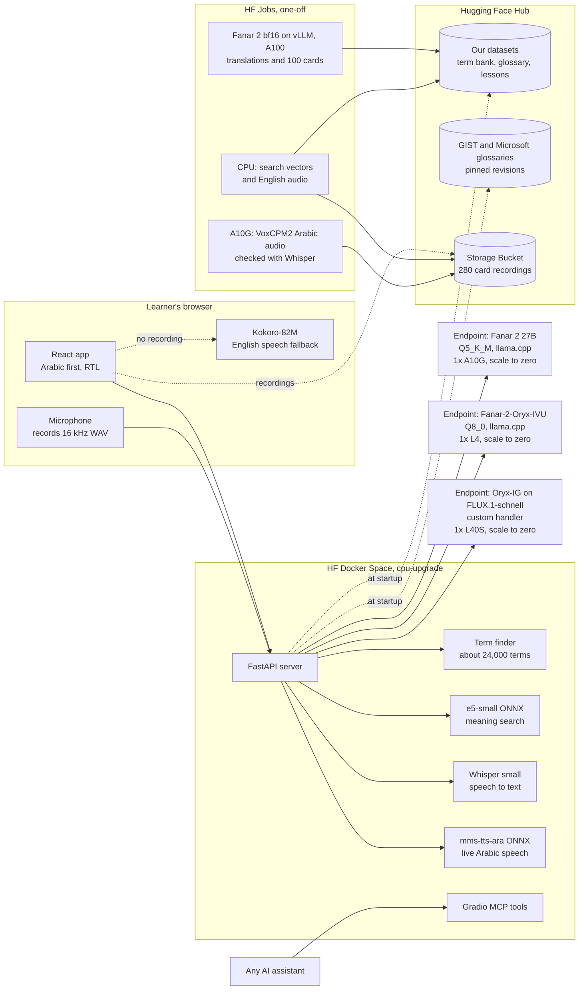

# Darbi (دربي)

**A Qatari model teaching Qataris the language of AI.**

Darbi ("my path") helps graduates of Qatar's Mostaqila schools understand the English language of AI and use AI well at work, explained in the Gulf dialect they speak every day, through short game mechanics. Its brain is Fanar 2, the Arabic model built in Qatar by QCRI, served on Hugging Face. Everything runs on Hugging Face.

Built for the Qai x Hugging Face Hackathon 01, Doha, 5 and 6 November 2026.

- App: https://huggingface.co/spaces/FayezAlkh12/darby
- Code: https://github.com/AshrafZohdi/arabize-hf

## The problem

Graduates of Qatar's Mostaqila schools are expected to use AI at work, but the tools, the material and the vocabulary are in English. A new employee gets an email that says "check it for hallucinations and give the model more context in your prompt" and has no one to ask. Arabic options are short workshops, paid video courses or scattered videos.

## What Darbi does

| Feature | What the learner does | Under the hood |
|---|---|---|
| **Smart Explain** (اشرح لي) | Pastes an English work text and taps فهّمني | Terms are found without AI in a 24,000-term bank and marked: teal if in the learner's dictionary, maroon if new. Fanar 2 then streams a plain explanation in Gulf Arabic, simple Arabic or English, writes cards only for terms the glossary lacks, and asks one practice question. Private-looking text (emails, phone numbers, QID-like numbers) gets a warning first. Nothing is stored |
| **Glossary** (القاموس) | Searches in Arabic or English, opens cards, listens | 140 full cards plus about 24,000 terms from Darbi, GIST and the Microsoft glossary. Word search, aliases (الأوامر finds Prompt) and meaning search with multilingual-e5-small |
| **Tutor** (المعلّم) | Asks questions about a lesson | Fanar 2 grounded in the lesson and glossary, streamed, labels general knowledge, declines unrelated requests, 20 messages per session |
| **Prompt lab** (مختبر الأوامر) | Writes a prompt for a Doha work task | Fanar 2 scores goal, context, format and constraints from 0 to 5 with feedback in the chosen language and an improved prompt that uses placeholders instead of invented facts |
| **Your path** (دربك) | Takes 7 short lessons | One step per screen, four exercise types, tappable terms, back and jump between steps, resume where you left off, points and a streak |
| **Daily code** (شيفرة اليوم) | Guesses today's term in 6 tries, English or Arabic | The server picks the word by Qatar date and marks guesses; the game state is a signed token, so the word never reaches the browser before the game ends |
| **Voice** | Taps EN or ع on a card | 280 recordings in a Storage Bucket: Arabic recorded with VoxCPM2 in a GPU Job and checked word by word with Whisper large-v3, English with Kokoro-82M. Words without a recording: Arabic from mms-tts-ara on the Space CPU, English from the device's own voice or Kokoro in the browser |
| **Speech to text** | Taps the microphone on any input | Whisper small (faster-whisper) on the Space CPU; the browser records 16 kHz WAV; nothing is stored |
| **Photo explain** | Photographs an English screen or email | Fanar-2-Oryx-IVU on its own endpoint copies the English text into Smart Explain |
| **Image prompt lab** (ارسم) | Writes a prompt for an image | Fanar 2 scores it and writes a better English prompt, checks it is suitable for work, then Fanar-2-Oryx-IG draws it |
| **Translate** | Taps ترجم on a reply or card | Fanar 2 translates between English and Gulf or Standard Arabic |
| **MCP tools** | Any AI assistant can use Darbi's glossary | `lookup_term`, `explain_text`, `todays_code_clue` at `https://fayezalkh12-darby.hf.space/mcp-tools/gradio_api/mcp/` |

Arabic first and right to left, with an English interface toggle. Works at 360 px wide. Points, streaks and saved terms live in the browser (no accounts).

## Architecture



Every call to Fanar 2 and Oryx-IVU goes through `server/llm.py` (the drawing endpoint is called from `server/routes/images.py` after a Fanar safety check): reasoning switched off through Fanar's chat template, think blocks stripped from every reply and stream, JSON validated with pydantic and schema-guided decoding, one retry, learner text wrapped and escaped, a rate limit per IP, and recorded answers when the endpoint is asleep or `DEMO_MODE=1`.

## Hugging Face products used

| Product | Use |
|---|---|
| Spaces (Docker) | The whole app, `FayezAlkh12/darby` |
| Inference Endpoints | Fanar 2 27B (Q5_K_M GGUF, llama.cpp, 1x A10G), Fanar-2-Oryx-IVU (Q8_0 GGUF, llama.cpp, 1x L4), Fanar-2-Oryx-IG on FLUX.1-schnell (custom handler, 1x L40S); all scale to zero after 15 idle minutes |
| Jobs | Stage 3 translations and the 100 cards with full bf16 Fanar 2 on vLLM (1x A100); search vectors and English audio on CPU; Arabic voice comparison and the 140 VoxCPM2 recordings on A10G, checked with Whisper large-v3; a CPU copy of the Oryx-IVU files |
| Hub datasets | `nuvais/darby-term-bank`, `nuvais/darby-ai-glossary-ar-en`, `nuvais/darby-lessons`, with bilingual cards. The Space loads them at startup |
| Hub models | The models in the table below, and our own repos: the Fanar 2 and Oryx-IVU quantized copies and the Oryx-IG endpoint handler |
| Storage Buckets | `FayezAlkh12/darby-media`: pre-generated term audio, written by Jobs through a bucket mount |
| Transformers.js | Kokoro English speech in the learner's browser, at no server cost |
| Gradio MCP server | Darbi's glossary as tools for any AI assistant |

## Models and datasets

| Name | Role | Licence |
|---|---|---|
| [QCRI/Fanar-2-27B-Instruct](https://huggingface.co/QCRI/Fanar-2-27B-Instruct) | Every AI feature | Apache 2.0 |
| [nuvais/Fanar-2-27B-Instruct-Q5_K_M-GGUF](https://huggingface.co/nuvais/Fanar-2-27B-Instruct-Q5_K_M-GGUF) | Endpoint weights (from mradermacher's quantization) | Apache 2.0 |
| [intfloat/multilingual-e5-small](https://huggingface.co/intfloat/multilingual-e5-small) | Search vectors | MIT |
| [openbmb/VoxCPM2](https://huggingface.co/openbmb/VoxCPM2) | Arabic voice of the 140 term cards, recorded in a GPU Job and checked word by word with Whisper | Apache 2.0 |
| [Systran/faster-whisper-small](https://huggingface.co/Systran/faster-whisper-small) (OpenAI Whisper small) | Speech to text for the microphone buttons | MIT |
| [facebook/mms-tts-ara](https://huggingface.co/facebook/mms-tts-ara) via [Xenova/mms-tts-ara](https://huggingface.co/Xenova/mms-tts-ara) | Live Arabic speech for words without a recording | **CC BY-NC 4.0: non-commercial, fine for this demo; a commercial launch needs another Arabic voice** |
| [Kokoro-82M](https://huggingface.co/hexgrad/Kokoro-82M) via [onnx-community/Kokoro-82M-v1.0-ONNX](https://huggingface.co/onnx-community/Kokoro-82M-v1.0-ONNX) | English speech | Apache 2.0 |
| [QCRI/Fanar-2-Oryx-IVU](https://huggingface.co/QCRI/Fanar-2-Oryx-IVU) via [nuvais/Fanar-2-Oryx-IVU-Q8_0-GGUF](https://huggingface.co/nuvais/Fanar-2-Oryx-IVU-Q8_0-GGUF) (from mradermacher's quantization) | Photo explain: reads the English text in a photo (behind `IMAGE_ENABLED`) | Apache 2.0 |
| [QCRI/Fanar-2-Oryx-IG](https://huggingface.co/QCRI/Fanar-2-Oryx-IG) on [black-forest-labs/FLUX.1-schnell](https://huggingface.co/black-forest-labs/FLUX.1-schnell) | Draws image prompts in the image prompt lab (behind `IMAGE_ENABLED`, endpoint `darby-oryx-ig`, 1x L40S) | Apache 2.0 (FLUX.1-schnell is gated: accept its terms first) |
| [Jerry999/multilingual-terminology](https://huggingface.co/datasets/Jerry999/multilingual-terminology) (GIST, [arXiv 2412.18367](https://arxiv.org/abs/2412.18367)) | Human Arabic for about 4,800 AI terms | Apache 2.0 |
| [ymoslem/MS-Glossary-EN-AR](https://huggingface.co/datasets/ymoslem/MS-Glossary-EN-AR) | About 22,000 software terms (Microsoft localisation) | Not stated on its card; used for the hackathon and referenced, never re-uploaded |

Our datasets are Apache 2.0.

## The data pipeline

`data/pipeline.py`, binding spec in `docs/DATA_PIPELINE.md`. Sources pinned by revision and checked by sha256; executed EDA notebook in `notebooks/eda.ipynb`, report in `data/reports/eda.md`.

| Step | Count |
|---|---|
| Rows in (Darbi 40, GIST 4,844, Microsoft 22,061) | 26,945 |
| Dropped: UI sentences over 8 words (each logged) | 52 |
| Merged duplicates (same matching key) | 2,893 |
| Terms after cleaning | 24,000 |
| Acronyms given a full English form by Fanar 2 | 265 |
| Terms given an Arabic translation by Fanar 2 (they had none, or only Latin letters) | 101 |
| Flagged for human review | 203 |
| Held back (no Arabic meaning yet) | 1 |
| Published and live | 23,999 |

What the EDA changed: Microsoft's single words would have marked 31.5 words in every 100 of ordinary work text ("send", "client", "check"), so only those that GIST also uses in at least 5 AI terms are highlighted. The sources disagree on core terms (prompt: Darbi أمر, GIST موجه, Microsoft مطالبة) and on 146 terms overall; Darbi's choices win for its terms and other prompt terms are flagged. Fanar's expansions are checked against the bank in the same domain and against the human Arabic where it exists, which caught GCC (Fanar: Gulf Cooperation Council; the Microsoft Arabic: Government Community Cloud), ERP and A2C. Data quality gates run in pytest.

## Measured

| | |
|---|---|
| Smart Explain on 1x A10G | First words 2.8 to 3.4 s, full answer 12 to 19 s (Gulf demo email) |
| Tutor | First token 2.3 s, answer about 7 s |
| Prompt lab | About 17 s |
| Fanar 2 Q5_K_M generation | 22.5 tokens/s on A10G (11.5 on L4, which we moved off) |
| Endpoint cold start from zero | About 4 minutes |
| Stage 3 Job (324 terms, A100) | 49 s of generation, 4.2 min in total |
| Term bank rebuild at Space startup | About 20 s |
| Search | 8 to 20 ms per query |

**Compute spend so far: about USD 6 of 100, estimated** (log in `docs/BUDGET.md`; endpoint figures are estimates until checked on the billing page).

## What is real, what is recorded

Live: everything, when the endpoint is awake. When it is asleep, failing or `DEMO_MODE=1`, Smart Explain shows a "waking up" note with a glossary-only answer and question, and the demo inputs (the hallucination email in Gulf, MSA and English, one tutor question, one prompt lab prompt) return real Fanar answers recorded earlier from the same prompts (`server/fixtures/`). The daily code, glossary, search, lessons and voice never need the endpoint.

## Honest limits

- **No language review yet.** Darbi's 40 terms and 7 lessons were drafted with AI for the earlier Arabize app; the 100 new cards and 101 translations were written by Fanar 2. Every dataset says so (`reviewed` is false except reviewer overrides). A Gulf Arabic speaker on the team is reviewing.
- Fanar sometimes drifts from Gulf to MSA; the prompts repeat the language rule next to the learner's text, which fixed it in our tests, but not every answer has been checked.
- The search model leans on shared words, so meaning search runs among the full Darbi cards.
- No accounts: progress stays in the browser.
- No fine-tuning: the models are used as published, shaped by prompts and our data.
- Speech to text uses Whisper small for speed; dialect words can come out slightly wrong.
- The image model does not always follow every detail of a prompt.
- Live Arabic speech for words outside the 140 cards still uses mms-tts-ara (guesses vowels, non-commercial licence).
- Arabic plurals in search work only where the plural starts like the singular (not أوامر).
- The quality and kernels evaluation (step 8 of the plan) has not been run yet.

## Run it

```bash
# server (Python 3.11)
uv venv --python 3.11 .venv && uv pip install -r requirements-dev.txt
.venv/bin/uvicorn server.main:app --reload --port 7860

# web (Node 22)
cd web && npm install && npm run dev   # http://localhost:5173, proxies /api to 7860

# every check the Space build depends on
scripts/gate.sh

# container, as the Space runs it
docker build -t darby . && docker run -p 7860:7860 darby
```

Configuration (Space variables and secrets): `HF_TOKEN` (secret), `FANAR_ENDPOINT_URL`, `FANAR_MODEL`, `HF_BUCKET`, `VOICE_ENABLED`, `DEMO_MODE`, `MCP_ENABLED`. See `.env.example`. Data pipeline: `pip install -r requirements-data.txt`, then `python -m data.pipeline stage0`, `stage2`, the stage 3 Job, `stage3`, `publish`.

Decisions are in `docs/DECISIONS.md`, the budget in `docs/BUDGET.md`, screenshots in `docs/screenshots/`.
