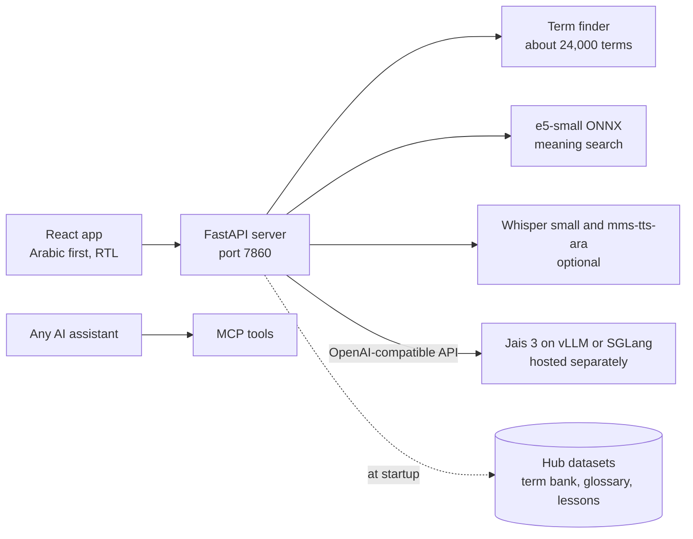

# Darbi (دربي)

Darbi ("my path") helps students and graduates of Qatar's Mostaqila schools understand the English of AI and technology and use AI well in their studies and at work, explained in the Gulf dialect they speak every day.

It began at the Qai x Hugging Face Hackathon 01 (Doha, 5 and 6 November 2026) and is now being built as a product. The hackathon plans are kept in `docs/hackathon/` for history.

## What a learner can do

| | The learner | Under the hood |
|---|---|---|
| **Explain** (الرئيسية) | Pastes any English text (an email, a lesson, an article) and taps فهّمني | Terms are found without AI in the term bank and highlighted. Jais 3 streams a plain explanation in Gulf Arabic, simple Standard Arabic or English, writes cards for terms the glossary lacks and asks one practice question. Text that looks private (emails, phone numbers, QID-like numbers) gets a warning first. Nothing is stored |
| **Learn** (تعلّم) | Takes 7 short lessons and plays today's word game | One step per screen, four exercise types, resume where you left off, points and a streak. The daily code is picked by Qatar date; its state is a signed token, so the word never reaches the browser before the game ends |
| **Glossary** (القاموس) | Searches in Arabic or English, opens cards, listens | 140 full cards plus about 24,000 terms from Darbi, GIST and the Microsoft glossary. Word search, aliases and meaning search with multilingual-e5-small |
| **Tutor** (المعلّم) | Asks questions, with or without a lesson open; practises writing prompts | Jais 3 grounded in the lesson and glossary, streamed, general knowledge labelled. The prompt lab scores goal, context, format and constraints from 0 to 5 and writes a better prompt with placeholders instead of invented facts |
| **Voice** | Taps listen on a card, or the microphone on an input | Recorded term audio, mms-tts-ara and Kokoro for speech, Whisper small for dictation (both optional, see `.env.example`) |
| **MCP tools** | Uses Darbi's glossary from any AI assistant | `lookup_term`, `explain_text`, `todays_code_clue` at `/mcp-tools` |

Arabic first and right to left, with an English interface. Works at 360 px wide. Points, streaks and saved terms live in the browser (no accounts).

## The model: Jais 3

Every AI feature runs on [inception42/Jais-3-375B-A23B](https://huggingface.co/inception42/Jais-3-375B-A23B) through an OpenAI-compatible server that you host (vLLM or SGLang). Set `JAIS_BASE_URL` and Darbi does the rest. **Read `docs/JAIS.md` before planning a deployment:** the model card's reference hardware is 16 H100 or 8 H200 GPUs, and no hosted provider serves it.

`server/llm.py` is the only code that talks to the model: the model card's sampling settings on every request, reasoning kept out of what the learner sees, JSON validated with pydantic with one retry, learner text wrapped and escaped, a timeout and a rate limit per client. Without a model server the app still runs: Smart Explain falls back to the glossary and the other AI features say they are unavailable.

## Gulf Arabic data

- **Glossary and lessons** carry Gulf fields (`term_gulf`, `def_gulf`, `example_gulf`) alongside Standard Arabic and English.
- **Gulf markers** (`content/gulf-markers.json`): 28 everyday Gulf words with Standard Arabic and English glosses, 25 of them picked by hand from the Gulf frequency list of [drelhaj/Arabic-Dialects](https://huggingface.co/datasets/drelhaj/Arabic-Dialects) (El-Haj et al., LREC 2018). The prompts show them to the model as the tone to write in, and `server/dialect.py` counts them in Gulf answers so drift to Standard Arabic can be measured.
- **Looked at and not added** (November 2026): QCRI's AraDiCE sets are CC BY-NC-SA (non-commercial); MADAR has Doha sentences but a research-only licence; `AhmedSSabir/Gulf-Arabic-Tweets-2018-2020` (CC BY 4.0) is raw tweets and would need filtering before a student product; `ebubekr53/organic-gulf-arabic-dialect-dataset` (CC BY 4.0) has 12 Qatari rows in its public sample. We found no openly licensed Gulf Arabic glossary of terms on the Hub.

## Architecture



## Other models and datasets

| Name | Role | Licence |
|---|---|---|
| [intfloat/multilingual-e5-small](https://huggingface.co/intfloat/multilingual-e5-small) | Search vectors | MIT |
| [openbmb/VoxCPM2](https://huggingface.co/openbmb/VoxCPM2) | Arabic voice of the 140 term cards (pre-recorded) | Apache 2.0 |
| [Systran/faster-whisper-small](https://huggingface.co/Systran/faster-whisper-small) | Speech to text | MIT |
| [facebook/mms-tts-ara](https://huggingface.co/facebook/mms-tts-ara) via [Xenova/mms-tts-ara](https://huggingface.co/Xenova/mms-tts-ara) | Live Arabic speech for words without a recording | **CC BY-NC 4.0: non-commercial. A commercial launch needs another Arabic voice** |
| [Kokoro-82M](https://huggingface.co/hexgrad/Kokoro-82M) | English speech | Apache 2.0 |
| [Jerry999/multilingual-terminology](https://huggingface.co/datasets/Jerry999/multilingual-terminology) (GIST) | Human Arabic for about 4,800 AI terms | Apache 2.0 |
| [ymoslem/MS-Glossary-EN-AR](https://huggingface.co/datasets/ymoslem/MS-Glossary-EN-AR) | About 22,000 software terms | **Not stated on its card. Settle this before launch** |
| [drelhaj/Arabic-Dialects](https://huggingface.co/datasets/drelhaj/Arabic-Dialects) | Gulf marker words | **CC BY 4.0 in metadata, "research purposes only" in the card. Confirm before launch** |

The term bank pipeline is `data/pipeline.py`, specified in `docs/DATA_PIPELINE.md`.

## Honest limits

- **Darbi has not yet answered from a real Jais 3 server.** The client is tested against a stand-in that speaks the same wire format; the prompts were written for the previous model and have not been tuned on Jais output. See "Not verified yet" in `docs/JAIS.md`.
- **No language review yet.** Darbi's 40 terms and 7 lessons were drafted with AI; 100 more cards and 101 translations in the published datasets were written by Fanar 2, the model the hackathon version used, and are labelled in the interface as AI-written and not reviewed. The glosses in `gulf-markers.json` are AI-drafted too.
- The lessons were written for graduates at work. They have not been rewritten for school students.
- The end-to-end browser tests in `web/e2e/` still target the hackathon demo mode, which was removed. They need rewriting against a stand-in model server, so `scripts/gate.sh` stops at that step.
- No accounts: progress stays in the browser.
- Speech to text uses Whisper small; dialect words can come out slightly wrong.
- Arabic plurals in search work only where the plural starts like the singular (not أوامر).

## Run it

```bash
# server (Python 3.11 or later)
python -m venv .venv && .venv/bin/pip install -r requirements-dev.txt
.venv/bin/uvicorn server.main:app --reload --port 7860

# web (Node 22 or later)
cd web && npm install && npm run dev   # http://localhost:5173, proxies /api to 7860

# checks
pytest
cd web && npm test && npm run build

# container
docker build -t darbi . && docker run -p 7860:7860 --env-file .env darbi
```

Configuration is in `.env.example`. On Windows the virtual environment's programs are in `.venv\Scripts\`.
